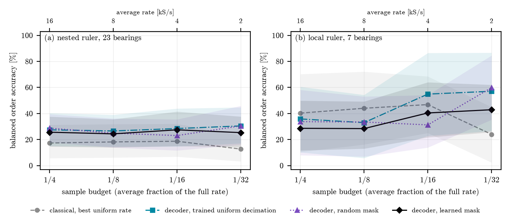

# E15 - Learned sampling mask under a feasible set

Number reserved in the experiment map as "learned sampling policy, realizable in hardware".
Opened on 2026-11-11 by [ADR 0006](../../docs/adr/0006-artigo-unico-computacional.md), as Part 2
(method) of the single paper. Runs on the server's GPU.

## Question

On front-end A (no tunable analog filter) and with the same samples/s budget, does a sampling
mask **learned against the task** outperform the published baselines of E22? The mask is
restricted to a feasible set: a periodic pattern on the tick grid, with a minimum spacing between
conversions.

## Feasible set

- **Grid:** the dataset's acquisition rate (Ottawa 200 kSPS; MAFAULDA 51.2 kSPS) is the tick
  grid.
- **Periodic pattern** with a period of L ticks and K active positions per period. The mean rate
  is K/L × fs, and with K/L = 1/budget the cost matches that of E22. This is periodic nonuniform
  sampling (multi-coset), realizable with TIMER and DPPI.
- **Minimum spacing** of g ticks between active positions, which represents the conversion time
  of a single SAR.

## Model

**The decoder is not a generic CNN.** It is the classical pipeline, unrolled and differentiable:
1. the masked, zero-filled signal;
2. a bank of learnable complex filters, which can represent linear multi-coset reconstruction of
   a band;
3. the squared envelope;
4. angular resampling from the tachometer or encoder, by differentiable interpolation;
5. the order spectrum.

The estimate is the same `estimate_without_prior` as in E22 (argmax over order), so the numbers
are comparable with those of E22.

**Loss:** cross-entropy over order bins, with a soft target at the true order (width of the 0.06
tolerance). It is task-oriented, as in `shlezinger2022taskadc`.

**Mask:** logits per position of the period, Gumbel top-K with straight-through. The construction
comes from `huijben2020dps` (DPS), and ADPS (`vangorp2021adps`) extends it to the adaptive case.
The minimum spacing enters through a penalty during training and through an exact projection at
the end. The projection-gap question (training under the constraint versus projecting afterwards)
has a precedent in MRI, `weiss2021pilot` (PILOT).

## Baselines

All are reimplemented, under the same protocol and the same budget. Table revised on 2026-11-11
by the adversarial review; the names are those of the `arm` column of `metrics.csv`.

| arm | reference | what it isolates |
|---|---|---|
| `uniform_trained`: best uniform rate chosen outside the test set | E22 | the best realizable classical method |
| `dec_uniform_trained`: same decoder, uniform at that factor | E07, E22 | decoder versus classical, at the same rate |
| `dec_uniform`: same decoder, uniform at the budget | E07, E22 | gain from learning the pattern |
| `dec_random`: fixed random mask, seeded | `sensors2025csvibration` | learned versus fixed random |
| `dec_multicoset`: multi-coset with the lowest peak alias | `zhao2018coprime`, `sun2013multirate` | learned versus designed without data |
| `dec_multicoset_vb`: multi-coset for a known support | `venkataramani2001optimal` | learned versus designed with the support |
| `dec_free_projected`: unconstrained top-K, then projected | `huijben2020dps`, `weiss2021pilot` | the **projection gap** (H2) |
| `dec_loupe_*` (optional): LOUPE, then projected | `bahadir2020loupe` | the same, with another sampler |
| `dec_adaptive_blocks`: block-adaptive, inspired by ADPS | `vangorp2021adps` | adaptive versus fixed |
| `wdcnn`: generic network on the uniformly decimated signal | `zhang2017wdcnn` | generic diagnostic network |
| `uniform_budget`, `uniform_oracle` | E22 | reference; the oracle uses the test label |

## Training protocol

- **Epochs:** a cap of **500**, with **patience-based early stopping** (40 epochs) on the
  validation loss. The best checkpoint is the one kept.
- **Validation split by record**, with no segment leakage. Splits repeated with the E05
  framework.
- **Repetitions:** 5 record-wise splits, with one training seed each (see the pre-registration).
- **Tuning:** the same hyperparameter budget for all learned methods (one learning rate, no
  search).
- **Datasets:** Ottawa decides; see the changes and corrections below.
- **Validation of the reimplementations:** before comparing, each baseline must reproduce
  something known. For example, the WDCNN at full rate on CWRU has a known number in the
  literature, and LOUPE has to recover the low-frequency mask in a toy example.

## Hypotheses

Text corrected on 2026-11-11. The previous version compared against `tat_rate` (the rate set by
E21's rate admissibility test, TAT) and against the oracle. `tat_rate` does not exist in this
experiment, and the oracle chooses with the test label. The exact test is in the
**pre-registration**, further below.

- **H1.** In at least two budgets, the learned mask (`dec_learned_sel`: the decoder with the
  learned mask, selected across budgets) has a higher balanced order accuracy than each of these
  three arms:
  - `uniform_trained`, the best uniform rate chosen outside the test set;
  - `dec_uniform_trained`, the same decoder with the uniform mask at that factor;
  - `dec_random`, the fixed random mask.

  It holds only if the two rulers agree.
- **H2.** The projection gap is greater than zero: training under the constraint from the start
  (`dec_learned`) is better than training the Gumbel top-K without the constraint
  and projecting afterwards (`dec_free_projected`).

## What would refute

- **H1 is refuted** if the pre-registration criterion fails on either of the rulers. Then Part 2
  is a negative result, and the paper reports it as such, as ADR 0006 requires.
- **H2 is refuted** if the pre-registration criterion fails. In that case the feasible set is not
  a contribution.

## Protocol changes (2026-11-11)

Requested by the coordinator after E21 and E22 ran. The design above stays as a record. Two items
were superseded by the adversarial review in the next section, and they are marked.

- **Datasets.** Ottawa (inner and outer races, with encoder) and CWRU 48k DE (constant speed from
  the record's rpm, `smith2015cwru` screening). **Superseded:** CWRU was removed from the
  decision (A2).
  - MAFAULDA is dropped and stays in the config as a disabled option. E21 showed that, in this
    bearing, BPFO = 2.998 and BPFI = 5.002 coincide with the 3rd and 5th shaft harmonics, and
    then a "hit" ends up measuring the shaft harmonic.
  - There is no test outside the training dataset: the tick grids of the datasets are not the
    same, and the mask does not transfer without resampling.
- **Budgets.** Ottawa: 1/4, 1/8, 1/16 and 1/32; 1/48 and 1/64 are optional. 96× to 160× do not
  serve as targets, because there the wall is the pipeline's, not the rate's.
- **Deciding baseline:** `uniform_trained`, the best uniform rate chosen on the records outside
  the test set of the same split. It is one factor per dataset, because the node does not know
  the family, and ties go to the higher rate.
- **Ground truth.** Center of the score plateau (`snq_recon.refine_order`), and not the first
  point, which lies about 0.0175 order below. The first point goes into the manifest.
  **Superseded:** the single ruler per record gave way to the two rulers (A1).
- **Isolated one-sample spikes in Ottawa** (about 1300/s, in all records). The results are
  reported in the `raw` and `despiked` variants, by the E20/E22
  criterion.
- **Selector floor.** In the learned decoder, the kurtogram's 500 Hz floor only initializes the
  bank. In the classical arms, on the grids used, the floor guard does not trigger. At a high
  factor, however, the floor narrows the search range; that is a pipeline wall.

## Corrections from the adversarial review (2026-11-11)

The first full run was interrupted before it finished. There was no test leakage, and
`uniform_trained` was correct, but the run was not valid because of two flaws (A1 and A2). The
resume key changed, and the run restarts from scratch.

- **A1. The outer-race line changes with the shaft speed within the record.** The coordinator
  measured, with `refine_order` at full rate per segment: O-A-1 goes from 3.519 at 16.7 Hz to
  3.322 at 25.8 Hz, and the inner race stays stable (variation ≤ 0.045). A constant label per
  record missed the line in a large share of the outer-race windows. Fix:
  - **local ruler**: `refine_order` at full rate on a sliding grid of 2.5 s windows, with a
    0.25 s step, over the training and validation records. Each training window gets the label
    of its own stretch, and a stretch with its plateau at the edge is dropped from training;
  - the same ruler chooses `uniform_trained`, on the segments of the records outside the test
    set;
  - the evaluation reports **two rulers side by side**: the full-rate line of the test segment
    itself, only for scoring and never for choosing, and the nested median of segment 0.
- **A2. As it stood, CWRU 48k decides nothing:** 12 outer-race records against 1 inner-race
  record, which never goes to test; a single class in the test set; 3 physical units. Choice:
  **(b), remove it from the decision.** The adapter stays, disabled in the config. Option (a),
  single-class BPFO detection, would answer another question and would have no per-record
  interval.
- **B1. The deciding comparison mixed decoder, mask and rate.**
  - `dec_uniform_trained` is added: the same decoder with the uniform mask at the factor chosen
    outside the test set.
  - The deciding learned arm, `dec_learned_sel`, chooses by validation among the trained
    budgets ≥ b. The criterion is the balanced accuracy by the local ruler, with ties broken by
    the lowest loss and then by the highest rate.
- **B2. Same stage budget.** Every searched mask becomes a `FixedMask`, and the decoder is
  retrained from scratch with it, under the same protocol as the fixed arms. The search-stage
  version is reported as `_norefit`.
- **B3. LOUPE.**
  - In the relaxed forward pass, the rate seen in training was 1.5 to 2.4 times the budget's.
    The projection gap now uses the unconstrained Gumbel top-K (`dec_free`): a horizon
    of 4 periods, counting only over the horizon, and no spacing. It is projected exactly with
    `fold_project`.
  - `masks.json` records the fraction of hard masks that violate g, and the projection of the
    initial map against the final one.
  - LOUPE stays optional, now with a hard forward pass and straight-through.
- **B4. Statistics.** Pre-registered in the next section, before any number.
- **B5. The mask could fail to get out of the noise.**
  - Initial logits of 0.01·randn and a learning rate of 0.001 to 0.003 with 8 steps per epoch,
    against Gumbel noise with a standard deviation close to 1.28. The mask now has its own
    learning rate: 10 times the decoder's (`mask.lr_multiplier`).
  - `masks.json` records the final logits, the margin between the K-th and the (K+1)-th logit,
    `last_hard_violations`, the `best_epoch`, and the final positions against the projection of
    the initial logits, which the seed reproduces.
- **B6.** The adaptive arm is called "block-adaptive, inspired by ADPS" (`dec_adaptive_blocks`).
  Since it has a single stage, it is compared with `dec_learned_norefit` (the stage-A
  decoder with the projected mask, without refitting).
- **B7.** `dec_multicoset_vb` is added: the multi-coset designed for the known support
  (`venkataramani2001optimal`; DOI checked on Crossref).
  - The support is the most frequent full-rate kurtogram band among the records outside the test
    set, shrunk until it fits in K cells.
  - The criterion is the noise amplification of the least-squares reconstruction. It is a reading
    in the spirit of the paper, whose exact bound **was not checked**, because the abstract was
    not available in the databases consulted.

## Pre-registration (2026-11-11)

Written before any number from the full run. The config mirrors the text in the `preregistration`
block, and the manifest records the sha256 of this README (`readme_sha256`). Changing the text or
the block after seeing a number invalidates the pre-registration.

- **Deciding dataset and variant:** Ottawa, `raw` variant. `despiked` is secondary, because
  removing spikes requires the full rate and is not realizable on the node.
- **Budgets:** 1/4, 1/8, 1/16 and 1/32.
- **Metric:** balanced order accuracy, that is, the mean, over the two races, of the fraction of
  test segments with |estimate − ruler| < 0.06 order.
- **Rulers.** Each hypothesis is tested on both, and holds only if the two agree.
  - **Local:** the full-rate line of the test segment itself.
  - **Nested:** the median of the segment-0 calibrations of the same race's records outside the
    test set.
- **Resampling unit:** the condition × scenario cluster, 4 per race (I-A to I-D and O-A to O-D).
  The 5 splits are also resampled.
  - Before resampling, each (split, record) is summarized by the mean over the segments and the
    seeds.
  - Each resample draws the splits and, within each race, the clusters, with replacement. The
    weight of a pair is the product of the counts.
  - There are 4000 resamples. The one-sided p is (1 + #{Δ* ≤ 0})/(1 + B).
  - **Eligibility:** the test is valid only with at least 3 clusters per race and 2 splits among
    the pairs. Below that, all resamples come out nearly equal, and the p would become 1/(1 + B)
    without measuring any variability; the test gets p = 1.
- **Seed and split.** There is one training seed per split, so seed variability is confounded
  with split variability. The bootstrap resamples the splits, and the interval carries both
  together. `protocol.seeds_per_split` separates the two, at a GPU cost.
- **Deciding comparisons and multiplicity.**
  - H1: `dec_learned_sel` against `uniform_trained`, `dec_uniform_trained` and `dec_random`,
    in the 4 budgets. That is 12 tests per ruler, with Holm correction over the 12.
  - H2: `dec_learned` against `dec_free_projected`, in the 4 budgets. That is 4 tests per
    ruler, with Holm over the 4.
  - α = 0.05.
- **Decision rule.**
  - A budget wins on H1 when its three tests are significant after Holm and with a positive
    difference.
  - H1 holds on a ruler when at least two budgets win; it holds in the experiment when it holds
    on both rulers.
  - H2 follows the same rule, with one test per budget.
  - `results/hypotheses.csv` lists each test, the adjusted p and the verdict.
- **Decides nothing:** the comparisons in `results/comparisons.csv`, which are reported without
  correction, the oracle, the `despiked` variant, the fault family, the WDCNN and the healthy
  control.
- **Mask convergence (B5), decided only by training diagnostics.** The mask "got out of the
  noise" when the margin between the K-th and the (K+1)-th logit exceeds the standard deviation
  of the Gumbel noise, π/√6 ≈ 1.28 (`mask_converged`). `summary.csv` gives the fraction of the
  splits in which this happened (`mask_converged_frac`).
  - If the fraction falls below 0.5 for `dec_learned`, in the `raw` variant, in any budget,
    the run is redone with `mask.lr_multiplier` = 30 **before** opening `hypotheses.csv`.
  - The switch is recorded here. It is an optimization decision made from training, not from the
    test.
  - **Applied on 2026-11-11.** In the run with `lr_multiplier = 10` (14:35–21:05 UTC), the
    `mask_converged_frac` of `dec_learned`, raw, was 0.6, 0.4, 0.4 and 0.2 from 1/4 to 1/32.
    The run was sealed in `results-lr10/`, without opening `hypotheses.csv` or `comparisons.csv`,
    and the config moved to `lr_multiplier = 30`.
  - **Run with `lr_multiplier = 30`** (started at 21:07 UTC on 2026-11-11). In the raw variant,
    the `mask_converged_frac` of `dec_learned` was 1.0 / 1.0 / **0.4** / 0.6 from 1/4 to 1/32.
    - The pre-registration provided for a single redo, and it did not fix 1/16.
    - **Deviation declared before opening `hypotheses.csv`:** in this run, H1 at 1/16 is
      **not evaluable** (the mask did not get out of the noise). 1/4, 1/8 and 1/32 are evaluated
      as pre-registered.
    - At the user's request, the run goes to the end; the variant without spikes is descriptive.
  - **Training diagnostic** (training only, never test): the 8 splits of the raw variant that did
    not converge have their best epoch in 22–84 and stopped by patience before the end of the
    temperature annealing (`tau_anneal_epochs = 100`). Those that converged, with one exception,
    trained beyond it.
  - **Pre-registration of the next run (B5, 2nd application):** `training.stop_after_anneal: true`.
    - In the arms with a learned mask and annealing, early stopping only counts, and the best
      checkpoint is only chosen, from `tau_anneal_epochs` onward (`FitConfig.min_epochs`).
    - The convergence criterion (margin > π/√6), `lr_multiplier = 30` and everything else stay
      the same.
    - If the fraction still falls below 0.5 in some budget of the raw variant, that budget is
      declared not evaluable, with no further redo.
  - **User's decision (2026-11-12, 01:23 UTC), before opening any test number from the 30×
    run:** the corrected run decides H1 and H2 in all budgets, with a single training procedure.
    - The decision came before the numbers because the corrected run can only improve the
      result. Deciding to run it only after seeing the 30× run would be choosing the run by its
      result.
    - The 30× run was interrupted in the `despiked` half, which decides nothing, and sealed
      without analysis in `results-lr30/` (`SEALED.md`). Since it did not reach the end, it
      did not produce `hypotheses.csv`. Only the training diagnostics came out of it
      (`convergence.txt`).
    - The corrected run runs only the `raw` variant (`despike_variants: [false]`). `despiked`
      is left for a later secondary run.
  - **Per-budget evaluability, in code** (`evaluable_budgets`; `min_mask_converged_frac` and
    `convergence_arms` in the `preregistration` block):
    - A budget is evaluable on a hypothesis only if the mask of each arm in `convergence_arms`
      got out of the noise in at least 0.5 of the splits.
    - The tests of a non-evaluable budget enter Holm with p = 1, which is conservative, and that
      budget cannot win. `hypotheses.csv` flags `evaluable` and the convergence of each arm.
    - **H1:** `dec_learned` (B5 as pre-registered) and `dec_learned_sel` (the mask actually
      used in each split, which may come from a sparser trained budget).
    - **H2:** `dec_learned` and `dec_free_projected`. In the 30× run, the free mask got out of
      the noise in only 1/5, 1/5, 1/5 and 0/5 of the splits (training diagnostic). Without this
      requirement, H2 would measure the projection gap against a baseline stuck in the noise.

  Check on the smoke-test slice (1/32, 120 steps, no early stopping; not a result):
  - with multiplier 1, the standard deviation of the logits went from 0.01 to 0.047, within the
    noise;
  - with 10, it went to 0.475, but the top-K margin was still 0.008.

  In both cases the best epoch was the last one. The full run has many more steps; the rule above
  decides.

## Caveats for the paper text

- **The scope is one bearing per class.** In Ottawa, each condition has its own bearing, so
  "fault family" is equivalent to "which bearing". This applies to the WDCNN, which classifies
  the family.
- **Published baselines are missing:** `han2024undersampledcnn`, `ahmed2018compressedbearing` and
  `zhao2026adaptive`.
- **`despiked` requires the full rate** and is not realizable on the node.
- **No T/H, jitter or conversion is modeled.** The samples are those of the dataset, on the tick
  grid. The `snq-sim` chain is not used.
- **Origin of the mask and of the gap question:** DPS (`huijben2020dps`) and PILOT
  (`weiss2021pilot`) must be cited as such.
- **The nRF54L15 was not checked.** The number of CC registers per TIMER was not verified. The
  48 kSPS grid cannot be scheduled at 16 MHz, because it gives 333.3 counts per tick.

## Implementation

| piece | where |
|---|---|
| feasible set, exact projection, `fold_project`, uniform, random, designed | `snq_learn/masks.py` |
| learned mask (DPS) with diagnostics, LOUPE, block-adaptive | `snq_learn/masks.py` |
| unrolled decoder (LPTV bank, squared envelope, order spectrum) | `snq_learn/order_decoder.py` |
| WDCNN from Table 2 of `zhang2017wdcnn`, checked against PMC5336047 | `snq_learn/wdcnn.py` |
| loop with epoch cap, patience, best checkpoint and per-group learning rates | `snq_learn/training.py` |
| rulers, arms, selection across budgets, pre-registration and cluster bootstrap | `run.py` |

Decisions that the design did not fix, or in which the implementation departs from it:

1. **K = 4 and L = 4 × budget.** With a small K, one TIMER with K compare registers is enough
   (`timer_schedule`). The spacing is g = 2 ticks in Ottawa (10 µs). The realizable value is a
   bench measurement, which was not made. At 16 MHz, the 200 kSPS grid gives 80 counts per tick.
2. **Time-periodic bank**, `Y_c(f) = Σ_r G_{c,r}(f)·Z(f − r·fs/L)`, with R = 5 shifts (R ≥ K).
   With only r = 0 it is LTI.
   - With the uniform mask, initialized at the kurtogram bands, it reproduces the uniform arm of
     E22 (there is a test for this).
   - It has 92 thousand parameters, against 54 thousand for the WDCNN. They are frequency
     responses on a 1024-point grid, not generic layers, but a reviewer may ask.
3. **Channel selection is the unrolled kurtogram:** `softmax(τ·SK + b)`. There is no learned term
   per order bin, so the model does not paint a peak where the spectrum has none.
4. **Fault family** for the order methods: the family whose central order (nested median) is
   closest to the estimate, within ±12%; outside that, "none". The WDCNN classifies directly, by
   soft voting over the segment's windows.
5. **Healthy control** (Ottawa H, never in training): the fraction of estimates within 0.06 of a
   fault order. The range/null-space decomposition is not defined, because there is no waveform
   reconstruction.
6. **Left out:** the validation of the WDCNN on 10-class CWRU 12k against the paper's number. It
   needs records that are not on the local machine, and the record-to-class mapping still needs
   to be checked. The validation of LOUPE on a toy example is in the tests.

## Status

Implemented, tested and smoke-tested on CPU (`config/smoke.yaml`, `results-smoke/`). **The smoke
test is not a result.** The full run uses `config/base.yaml` on the GPU server.

Each trained execution is stored in `results/runs/`. A restart resumes from where it stopped, as
long as the config, the code and the CLI do not change. `masks.json` gathers only the executions
of the current invocation.

Smoke test of the corrected protocol (2026-11-11). The slice is Ottawa scenario A, 1/16 and 1/32,
in both variants, with one split and at most 6 epochs. What it proves is mechanical:
- **Loop:** 40 executions and 480 rows. Early stopping triggered in 21 of 60 trainings.
- **Resume:** the 40 executions were resumed, and `metrics.csv` and `hypotheses.csv` came out
  byte-for-byte identical.
- **Local ruler:** 14 to 15 of the 15 windows per record came out valid. One test segment with
  its plateau at the edge was left out of the local scoring.
- **LOUPE:** with the hard forward pass, the rate in training was 0.0315 against 1/32.
- **Bootstrap:** with one split and one cluster per race, all tests come out ineligible (p = 1).
  The verdict comes out 0, as it should.

## Full run on the server (launched on 2026-11-11, 11:58 UTC)

> Interrupted by the adversarial review (see "Corrections from the adversarial review"). The
> environment below still applies to the relaunch.

- **Separate tree.** The run uses `~/snq/e15/sub_nyquist`, with the raw data symlinked to the main
  tree. The main tree is running the re-execution queue (E23 spikes, E07, E20, E22), and syncing
  `snq-learn` in it would change, in the middle of those runs, the source hash they record. The
  E15 manifest records the hash of its own tree.
- **Environment deviation.** The lock installs `torch 2.14.0+cu130`, but the server's NVIDIA
  driver only goes up to CUDA 12.6, and torch did not see the GPU. Only in this tree was
  `torch 2.14.0+cu126` installed, the same version with another CUDA build (index
  `download.pytorch.org/whl/cu126`). The run uses the `.venv` Python directly, because `uv run`
  would re-sync with the lock.
- **GPU.** RTX 4090 with 25.3 GB, selected by UUID with `CUDA_VISIBLE_DEVICES`. The server's
  other card is faulty: `nvidia-smi` fails on `0000:0C:00.0`.
- **Command.** `run.py --config config/base.yaml --workers 6`, with the 7 methods, the 2 datasets
  and up to 500 epochs with a patience of 40. On the GPU, bit-for-bit reproducibility is not
  guaranteed (see the CPU smoke test).

## Result of the deciding run (2026-11-12)

Run of 2026-11-12, from 01:35 to 05:48 UTC, at commit `314b0c3`.
- The four hashes in the manifest (source, config, `run.py` and README) match the commit.
- `git_sha` comes out null because the server tree is not a git checkout. The hashes cover that.
- This README gained this section after the run. The manifest's `readme_sha256` is that of
  commit `314b0c3`.

### Evaluability (B5), checked before opening the hypotheses

| budget | `dec_learned` | `dec_learned_sel` | `dec_free_projected` |
|---|---|---|---|
| 1/4 | 1.0 | 1.0 | 0.6 |
| 1/8 | 1.0 | 1.0 | 0.2 |
| 1/16 | 1.0 | 1.0 | 0.2 |
| 1/32 | 0.8 | 0.8 | 0.0 |

H1 is evaluable in all four budgets; H2, only at 1/4.

### Pre-registered verdict

- **H1 did not pass on either ruler.** None of the 24 tests is significant, not even before the
  correction: the smallest one-sided p is 0.20.
- **H2 is not supported.** It could only be evaluated at 1/4, where the difference was
  0.0 points: [−14.3, +11.4] by the local ruler and [−6.25, +6.25] by the nested one.

Balanced order accuracy (%), `raw` variant (`summary.csv`):

| arm | ruler | 1/4 | 1/8 | 1/16 | 1/32 |
|---|---|---|---|---|---|
| `uniform_trained` (classical, factor chosen in training) | local | 94.8 | 94.8 | 89.7 | 89.7 |
| `dec_learned_sel` | local | 93.1 | 89.7 | 79.3 | 74.2 |
| `dec_uniform_trained` | local | 91.4 | 86.3 | 79.3 | 75.9 |
| `dec_random` | local | 86.2 | 93.1 | 75.9 | 69.1 |
| `uniform_oracle` (chooses with the test) | local | 98.3 | 98.3 | 98.3 | 98.3 |
| `uniform_trained` | nested | 88.3 | 88.3 | 86.7 | 85.0 |
| `dec_learned_sel` | nested | 86.7 | 85.0 | 76.7 | 70.0 |
| `dec_uniform_trained` | nested | 90.0 | 86.7 | 78.3 | 75.0 |
| `dec_random` | nested | 81.7 | 90.0 | 73.3 | 68.3 |
| `uniform_oracle` | nested | 90.0 | 90.0 | 90.0 | 90.0 |

### Adversarial review (`reviewer-2`, 2026-11-12)

The pre-registered verdict stands, but the statement changes. The result is **absence of evidence
of a gain in a design without power**. It is not evidence that learning the mask does not help.

1. **The test could not pass.** With a perfect arm in place of `dec_learned_sel`, the same rule
   gives verdict 0 on both rulers.

   | against `uniform_trained`, perfect arm | 1/4 | 1/8 | 1/16 | 1/32 |
   |---|---|---|---|---|
   | uncorrected p, local ruler | 0.17 | 0.16 | 0.05 | 0.07 |
   | uncorrected p, nested ruler | 0.025 | 0.022 | 0.018 | 0.024 |

   After Holm, the p values are ≥ 0.43 (local) and ≥ 0.14 (nested). The reasons:
   - The classical method already gets 56 of 59 segments right at 1/4 and 1/8 by the local ruler,
     and the oracle, 58.
   - The inner race is at the ceiling in almost all arms. Only the 29 outer-race segments
     discriminate.
   - There are 4 clusters per race, of unequal sizes: on the outer race, 1, 5, 6 and 3 pairs.
   - The detectable difference against `uniform_trained` lies between 18 and 40 points by the
     local ruler and between 11 and 39 by the nested one, above the headroom up to the oracle.
2. **The deficit against the classical method comes largely from one record, O-C-2.**
   - O-C-2 is in the test set in 4 of the 5 splits and accounts for 8 of the 29 outer-race
     segments.
   - On it, all arms with the learned decoder return order 2.0, which is the lower edge of the
     search (`order_min`).
   - Without O-C-2 (exploratory), `dec_learned_sel − uniform_trained` becomes +4.6 / +2.3 / 0.0 /
     −3.9 points.
   - The probable mechanism, not proven: with the decoder's |y|² envelope, the order-2 line
     competes with the BPFO in this record.
   - The splits are Monte Carlo splits, and 6 of the 24 records never go to test.
3. **With the same decoder, the mask barely changes the decision.**
   - Between `dec_learned_sel` and `dec_uniform_trained`, 12 of 236 segments disagree (local
     ruler).
   - Outside 1/4, the learned masks do not agree across splits more than randomly drawn feasible
     masks do.
   - Two replicas that differ only in the seed (`dec_uniform_trained` at 1/4 and at 1/8, with the
     same factor) differ by about 5 points.
4. **There is no leakage, but the baseline has a degree of freedom that the mask does not have.**
   - `uniform_trained` chooses the factor in [b, 48] using only training and validation. It came
     out as 13 or 14 at 1/4 and 1/8, and from 30 to 46 at 1/16 and 1/32, that is, 2 to 3.5 times
     fewer samples than the budget.
   - The mask has L = 4b and K = 4 fixed.
   - That is why the comparison is "up to the budget", and not "at the same rate".
5. **`stop_after_anneal` did not make the deciding arm worse.**
   - Stage B stops early, and the validation has 8 windows.
   - The `_norefit` arms are equal to the refit ones or above them, and none goes beyond
     `uniform_trained`.
6. **The selection across budgets does not explain the negative.**
7. **H2:** the right term is "not supported", not "refuted". With 3 of 4 budgets not evaluable,
   "the feasible set is not a contribution" is too strong.
8. **`dec_adaptive_blocks` is noise until proven otherwise.**
   - It has the highest point values at 1/4 to 1/16.
   - But it is the maximum among 12 arms, it is outside the pre-registration, and it trained more
     than the others.
9. **There is no bug** in `per_record`, `cluster_bootstrap`, `holm` or `hypotheses`.
   `hypotheses.csv` is reproduced exactly from `metrics.csv`.
10. **Prior work and scope.**
    - In MRI, `bakker2022adaptive` finds learned policies tied with the equispaced one at 4×.
    - The result here holds for decimation of records at 200 kSPS, with an ideal sampler,
      without track-and-hold and without jitter.

### Statement for the paper

Part (b):

> On the Ottawa dataset (raw variant), in simulation by decimation of records at 200 kSPS, with
> no track-and-hold or jitter model, the mask learned under the feasible set did not outperform
> the best uniform rate chosen on the training records (which fell below the budget, between
> 1/13 and 1/46) in any of the four budgets, from 1/4 to 1/32. The differences in balanced order
> accuracy ranged from −1.7 to −15 points, with 95% cluster-bootstrap intervals between −46
> and +14 points, and none of the 24 pre-registered tests was significant. The design had no
> power: in simulation, not even a method that got every test segment right would pass the
> criterion.

H2:

> The projection gap could only be evaluated at 1/4, where it was 0.0 points [−14.3, +11.4]. In
> the other budgets, the pre-registered rule declared it not evaluable.

### Exploratory: stability of the mask used

Measured with `explore_mask_stability.py`, on training diagnostics only
(`results/exploratory/mask_stability.csv`). It is the fraction of the positions used that
survives the training Gumbel noise, as a median across splits.

| budget | learned | free, projected |
|---|---|---|
| 1/4 | 0.999 | 0.986 |
| 1/8 | 0.998 | 0.974 |
| 1/16 | 0.995 | 0.909 |
| 1/32 | 0.969 | 0.832 |

The masks are firm, so the result does not come from a mask stuck in the noise. The free
projected mask is more stable than the margin criterion suggested. This does not change the
evaluability, which was pre-registered.

### What unlocks what

1. **Power gate.** Runs on CPU, on the current `metrics.csv`: simulate the rule with the perfect
   arm and with planted effects (+5 and +10 points) in candidate designs. If nothing passes on
   Ottawa, H1 is not testable on it.
2. **Splits:** each record tested once and `seeds_per_split` ≥ 3. Depends on 1.
3. **After 2, in parallel:**
   - the ablation of the failure on O-C-2 (`envelope_power` 1 versus 2, and the `order_min`
     edge);
   - the classical decoder on the learned mask;
   - an arm that starts from the best uniform rate (`init: uniform`, with L = 4 × the chosen
     factor);
   - the same training budget for all arms.
4. **Adaptive arm as the pre-registered primary,** with a paired control. Depends on 2 and 3.

## Power gate (pre-registration, 2026-11-12)

Written before running. The gate answers one question: can Ottawa, in some design, detect by the
H1 rule an arm that is actually better than the baseline? It runs on CPU only, with
`power_gate.py`, on the `metrics.csv` of the deciding run.

- **Planted arm.**
  - It starts from the rows of `uniform_trained`. Each segment it gets wrong becomes a hit with
    probability q, with the same draw on both rulers. Where it is right, the planted arm is also
    right.
  - The q of each (budget, ruler) produces the requested effect in balanced accuracy. When the
    ceiling cannot accommodate the effect, q stops at the perfect arm (q = 1).
- **Effects:** +5 points (the deciding one), +10 points and the perfect arm.
- **Designs:**
  - **D0:** as run, with 5 Monte Carlo splits and 1 seed.
  - **D1 and D2:** with 3 and 5 seeds, emulated as independent draws of the planted arm and
    averaged per (split, record).
  - **DK:** each record tested once, in 4 folds stratified by race, with 5 seeds.
    - The classical grid is not cached, so the baseline is synthetic.
    - On each race, it gets each segment wrong at the observed mean error rate, which spreads the
      errors over all clusters.
  - **D3, only as an anticonservative reference:** D2 with a per-record bootstrap instead of a
    per-cluster one.
    - It is not a valid design for the paper, because records of the same condition × scenario
      are not independent.
    - It serves to measure how much the clustering limits the power.
- **Decision rules:**
  - **Pre-registered:** the H1 rule, with the three baselines and Holm over the 12 tests of each
    ruler. Applies in D0 to D3.
  - **Optimistic:** only the test against `uniform_trained`. The 8 tests against the learned
    baselines enter Holm as significant (p = 0). Applies in all designs and, in DK, is the only
    one.
- **Deliberate optimism.** The learned baselines stay fixed, with no seed noise, and the planted
  arm never gets worse. In DK, the classical method's errors are spread in the way most favorable
  to the test. That is why a "no" is conclusive, and a "yes" does not prove that a real design
  works.
- **Criterion:** H1 is testable on Ottawa if, in any of the designs D0, D1, D2 or DK, the power
  by the optimistic rule for +5 points is at least 80%. If not, H1 is not testable on Ottawa,
  and part (b) needs another dataset or leaves the paper.
- **Simulation:**
  - There are 200 repetitions per design and effect. The perfect arm, which outside DK varies
    only through the bootstrap, has 20.
  - Each test uses 2000 resamples, with a fixed seed.
  - Beforehand, the vectorized bootstrap is checked against the `cluster_bootstrap` of `run.py`
    on the real data.

### Power gate result (2026-11-12)

- **Execution:** `power_gate.py`, about 1 min of CPU. The outputs are in `results/power_gate/`
  (`power.csv`, `validation.json` and `baseline.json`).
- **Validation of the vectorized bootstrap** against the real `hypotheses.csv`: the point
  differences are identical, and the p values are within the Monte Carlo error (largest
  deviation of 0.026, with 4000 resamples on each side).

Power of H1, that is, the fraction of the repetitions in which the rule passes on both rulers:

| design | rule | +5 points | +10 points | perfect arm |
|---|---|---|---|---|
| D0 (as run) | pre-registered / optimistic | 0.00 / 0.00 | 0.00 / 0.00 | 0.00 / 0.00 |
| D1 (3 seeds) | pre-registered / optimistic | 0.00 / 0.00 | 0.00 / 0.00 | 0.00 / 0.00 |
| D2 (5 seeds) | pre-registered / optimistic | 0.00 / 0.00 | 0.00 / 0.00 | 0.00 / 0.00 |
| DK (each record tested once) | optimistic | 0.03 | 0.06 | 0.07 |
| D3 (per-record bootstrap, invalid) | pre-registered / optimistic | 0.00 / 0.00 | 0.00 / 0.00 | 0.00 / 0.00 |

**Verdict by the pre-registered criterion: H1 is not testable on Ottawa.** Among the valid
designs, the highest power by the optimistic rule with +5 points is 0.03. The criterion required
0.80.

- **The limit is the number of errors of the classical method.** `uniform_trained` gets only
  3 to 9 of the 59 or 60 test segments wrong, depending on the budget and the ruler, all of them
  on the outer race. The inner race has no error in any budget.
  - By the local ruler, at 1/4 and 1/8, the 3 errors are in O-A (the cluster's only valid
    segment) and in O-B.
- **Why not even the perfect arm passes in D0 to D2.**
  - In the optimistic rule, the 8 tests taken as significant occupy the first ranks of Holm.
  - Thus, the smallest p against `uniform_trained` would need to be below 0.05/4 = 0.0125.
  - The perfect arm reaches, at best, about 0.02, by the nested ruler.
- **More seeds do not change this,** because the baseline is deterministic. Nor does testing each
  record once, because there are still few errors to correct.
- **Not even the anticonservative reference passes the full rule.** That is D3, in which each
  record is a cluster.

**Consequence.**
- Part (b) of the paper cannot be decided on Ottawa.
- The question needs a dataset in which the baseline errs enough, spread over enough independent
  clusters, for a +5-point gain to be detectable.
- This calculation can be done before training, because the gate only needs the classical stage,
  which runs on CPU.

## Power gate on Paderborn (pre-registration, 2026-11-12)

Written before running, after the ingestion and the suitability check
(`datasets/manifests/paderborn.yaml`). The question is the same as for the Ottawa gate: can the
dataset detect, by the H1 rule, an arm that is actually better than the baseline? It runs on CPU
only, with `paderborn_gate.py` and `config/paderborn_gate.yaml`.

- **Records:** bearing × operating setting, in the three 1500 rpm settings. Measurement 1
  calibrates the nested ruler, and measurements 2 to 20 are the test segments, 4 s each
  (100 revolutions, 0.010 order of resolution).
- **Groups and clusters:** the race is the group, and the bearing is the bootstrap cluster.
  - Outer race: 12 bearings (7 with artificial and 5 with real damage).
  - Inner race: 11 bearings (5 with artificial and 6 with real damage).
  - Left out: the combined ones (KB), whose order family is ambiguous, and the healthy ones.
- **Splits:** K-fold by bearing, with 4 folds stratified by race. Each bearing is tested once,
  and none appears in both the training and the test set of the same fold.
- **Classical pipeline:** that of E15, with four changes.
  - **Tolerance of 0.025 order**, instead of 0.06. BPFO and BPFI lie 0.054 from shaft
    harmonics 3 and 5.
  - **Ruler search within ±1% of the nominal**, instead of ±12%, to exclude 3.0 and 5.0.
  - **Kurtogram ceiling at the effective Nyquist.**
  - **Guard of 1.0 × 64 points per revolution**, the same as for CWRU in E15. With 2.0, factor
    32 would not run.
- **Local ruler:** the full-rate line of the segment itself.
  - It is valid only if it does not touch the search edge and if the peak, within ±0.015 order
    of the center, is at least 5 times the median of the ±7% window around the nominal.
  - In the suitability check, the visible lines gave 14 to 141, and the absent ones 0.3 to 2.5.
- **Nested ruler:** the median of the valid measurement-1 calibrations of the records outside the
  test set, on the same race. It applies to all test segments, including those of bearings
  without a visible line.
- **Baseline:** `uniform_trained`, the best uniform rate up to the budget, chosen by the local
  ruler on the records outside the test set.
- **Gate:** that of Ottawa, with arms planted from the baseline (+5 points, +10 points and
  perfect) and 1, 3 or 5 seeds (D0, D1 and D2).
  - Only the optimistic rule: there is no learned arm, so the 8 tests against the learned
    baselines enter Holm as significant.
  - There are 200 repetitions per design (20 for the perfect arm) and 2000 resamples per test.
- **Criterion:** H1 is testable on Paderborn if the power for +5 points, on both rulers, is at
  least 80% in any of the designs D0, D1 or D2.
  - If so, E15 runs on Paderborn, with the learned arms and the corrections from the adversarial
    review, after its own pre-registration.
  - If not, part (b) leaves the paper.
- **Correction before any number (2026-11-12, found in the smoke test).**
  - The number of 64 kHz samples per file varies (from 255999 to 262062), but the time axis
    always goes from 0 to 4 s.
  - The PMSM current, which turns at 4× the shaft speed, shows that the rate is a fixed 64 kHz:
    median ratio of 0.99998, with 1 file out of 2559 above 0.5%.
  - The loader now cuts the vibration at 4 s, aligned with the speed channel.
  - One file does not open (`KA08/N15_M01_F10_KA08_2.mat`). The measurement is left out and
    recorded in the manifest.
  - Nothing in the protocol above changed.

### Gate result on Paderborn (2026-11-12)

The classical stage took 3246 s on 28 CPU processes. The outputs are in `results-paderborn-gate/`
(`power.csv`, `metrics.csv`, `truths.json` and `manifest.json`).

| design (optimistic rule) | +5 points | +10 points | perfect |
|---|---|---|---|
| D0 (1 seed) | 0.74 | 0.99 | 1.00 |
| D1 (3 seeds) | **1.00** | 1.00 | 1.00 |
| D2 (5 seeds) | **1.00** | 1.00 | 1.00 |

**Verdict by the pre-registered criterion: H1 is testable on Paderborn, with at least 3 seeds
per fold.** On Ottawa, not even the perfect arm passed.

- **There is room for a gain.** `uniform_trained` gets 41.5 / 44.8 / 49.7 / 26.7% right by the
  local ruler and 16.8 / 17.4 / 18.6 / 13.2% by the nested one, from 1/4 to 1/32.
- **Local ruler:** only 6 of the 23 bearings have a visible full-rate line in measurement 1
  (KA01, KA06, KA16, KI01, KI16 and KI18). There are 180 segments out of 1291 with a local
  ruler.
- **Nested ruler:** applies to all segments.
  - It includes bearings without a visible signature, on which perhaps no method gets it right.
  - The gate measures whether the test can detect the gain, not whether the gain is achievable.
- **Measurements left out: 21.**
  - 1 unreadable; 2 with ~3.9 s; 3 with a speed channel of the wrong duration.
  - 15 are only 3 to 5 samples short of 4 s. This criterion was too strict, and the E15 run on
    Paderborn relaxes it: it accepts up to 1 ms less.
  - This does not change the verdict, with a power of 1.00.
- **Consequence:** part (b) returns to the paper, conditional on E15 on Paderborn. It will have
  its own pre-registration, the corrections from the adversarial review and 3 seeds per fold.

## E15 on Paderborn (pre-registration, 2026-11-12)

Written before running, after the power gate passed. The config is `config/paderborn.yaml`,
derived from `config/base.yaml`. Hypotheses H1 and H2, the decision rule, Holm, the evaluability
rule (B5) and the cluster bootstrap of the "Pre-registration" section apply, with the changes
below.

- **Data:** those of the gate.
  - 23 bearings (12 outer-race and 11 inner-race) in the three 1500 rpm operating settings.
  - Measurement 1 calibrates; measurements 2 to 20 are the segments, cut at 255936 samples.
  - A measurement that does not open or that is shorter than that is left out.
- **Splits:** K-fold by bearing, with the 4 folds of the gate (a test checks this).
  - Validation comes from the bearings outside the test set, with 25% per race and at least 1.
  - The bootstrap cluster is the bearing.
- **Seeds:** 3 per fold. The gate gave a power of 1.00 for +5 points with 3 seeds, and of 0.74
  with 1.
- **Rulers:** those of the gate.
  - The local one is valid only where the line is visible at full rate (peak of at least 5× the
    median).
  - The nested one applies to all segments.
  - Tolerance of 0.025 order, ruler search within ±1% of the nominal.
- **Training and validation labels:** the nested ruler, because the local one exists only for 6
  of the 23 bearings.
  - The decoder has no learned per-order term, so it cannot return the race's order without a
    line in the spectrum.
- **Methods:** those of Ottawa, minus `dec_adaptive` and `wdcnn`, which decide
  nothing.
- **Guard:** 1.0 × 64 points per revolution, as in the gate.
- **Corrections from the adversarial review:**
  - adopted: K-fold by bearing and 3 seeds;
  - not adopted in this run: the classical decoder on the learned mask, the arm that starts from
    the best uniform rate, and the equal training budget. They remain as a declared limitation.
- **What refutes:** the same as in the "What would refute" section. With the gate passing, a
  negative here is evidence of the absence of a gain of at least 5 points in this task, and not
  a lack of power.

### Parallel execution on Paderborn (2026-11-12)

The design, the folds, the seeds, the methods and the criteria remain those of the
pre-registration above. Only the number of processes computing the cells changes.

- **Why.** The main run started the GPU stage at 15:27 UTC.
  - According to NVML, the GPU stayed at about 6% utilization, with 3.2 GiB and 76 W.
  - The main process occupies one CPU core (87%), so training is bound by Python, not by the
    GPU.
  - The first execution on Paderborn (`dec_uniform`, 1/4, fold 1, seed 1) took 181 s. On
    Ottawa, the mean for this method was 55 s. The run has 48 cells (4 folds × 3 seeds ×
    4 budgets) of 7 methods.
- **How.** `shard.py` runs the cells it receives in other processes, on the same GPU.
  - It uses the same `run.py`, unchanged, and stores each execution in `runs/` with the same
    `run_key`.
  - The `run_key` covers the config, `run.py`, the package code and the CLI that changes the
    result. `--budgets` and `--workers` are not part of it.
  - The main process, on reaching a cell already stored, resumes it, and its manifest marks it
    as `"resumed"`.
- **What guarantees that the result is the same.**
  - The shards call `run.run_method` with the same context. The data seed comes from
    `derive_seed` per cell, and cudnn is deterministic.
  - The shards exit before `summarize`. That is why they do not write `metrics.csv`,
    `summary.csv`, `hypotheses.csv`, `masks.json` or the manifest. These are written by the
    main process, which goes through all the cells.
  - Each shard execution is stored atomically (temporary file + `os.replace`), and the main
    process never reads a half-written JSON.
  - The shards' classical stage comes from a cache. Its key is the hash of the config, of
    `run.py` and of the packages, and a cache with another key is rejected.
- **Validation before use** (local, CPU, Ottawa smoke config, 4 methods, 3 epochs):
  - `metrics.csv`, `summary.csv`, `hypotheses.csv` and `comparisons.csv` came out **identical**
    to those of a run without shards.
  - The stored executions differ only in wall-clock time (`info/.../seconds`). This also holds
    for those that the main process computed itself, so it does not come from the shard.
  - The main process's manifest marks as `"resumed"` the 4 executions computed by the shard.
  - No temporary file was left behind.
- **Provenance.**
  - The main process runs in the server checkout created at commit `4e3bf37`. The manifest's
    `readme_sha256` will be that of this commit, because this README only changes in the local
    repository.
  - `shard.py` entered the server checkout as a new file, and it does not change any hash of the
    `run_key`.

## Result on Paderborn (2026-11-13)

- **Run:** `results-paderborn/`, with 336 executions, 4 bearing-wise folds × 3 seeds ×
  4 budgets × 7 methods.
  - The classical stage ran once and served as a cache for the shards (`shard.py`).
  - `metrics.csv` is stored compressed (`metrics.csv.gz`); the `runs/` stay on the server.
- **Evaluability (B5), checked before the hypotheses:**
  - The constrained mask converged in 92, 83, 75 and 92% of the 12 executions per budget, from
    1/4 to 1/32. The selected one converged in 83, 75, 83 and 92%. **H1 is evaluable in all
    four.**
  - The free projected one converged in 33, 0, 17 and 42%. **H2 is not evaluable in any.**
- **Pre-registered verdict: H1 does not pass in any budget, on either ruler.** 0 of 24 tests are
  significant.
  - **Nested ruler:**
    - against `dec_uniform_trained`: −1.8, −2.2, −1.0 and −5.2 points;
    - against `dec_random`: −3.1, −0.5, +4.4 and −5.2;
    - against `uniform_trained`: +8.3, +6.2, +8.8 and +12.6.
    - The smallest one-sided p is 0.037 (1/32, against `uniform_trained`, CI from −1.1
      to +28.2). Holm takes it to 0.44.
  - **Local ruler** (17 records, 7 clusters): from −16.9 to +18.9 points, with nothing
    significant.
- **Balanced accuracy, nested ruler (%):**

  | arm | 1/4 | 1/8 | 1/16 | 1/32 |
  |---|---|---|---|---|
  | `dec_learned_sel` | 25.7 | 24.4 | 27.5 | 25.4 |
  | `dec_uniform_trained` | 27.5 | 26.7 | 28.5 | 30.5 |
  | `dec_random` | 28.7 | 25.0 | 23.1 | 30.6 |
  | `dec_multicoset_vb` | 26.2 | 23.6 | 26.5 | 34.8 |
  | `uniform_trained` (classical pipeline) | 17.4 | 18.3 | 18.8 | 12.7 |

- **Reading:**
  - **The margin over the classical pipeline belongs to the decoder, not to the mask.** The
    trained uniform mask and the random one use the same decoder and are as far ahead as the
    learned one.
  - **With a power of 1.00 for +5 points** (gate on Paderborn), this is evidence against a gain
    of that size from the learned mask over trained uniform decimation and over the random mask.
  - **The limit is the classical pipeline,** already captured at full rate on Paderborn (E24),
    and the nested ruler that labels the training.
- **Paper numbers:** `papers/shared/figures/num_partB_paderborn.py` →
  `papers/mssp-2026/numbers/partB_paderborn.json`.

## Where the decoder's margin on Paderborn comes from (exploratory, 2026-11-13)

Requested by the adversarial review of the manuscript. It is not pre-registered. Script:
`explore_line_split.py` → `results-paderborn/exploratory/line_split.csv` (same aggregation as
`summary.csv`, nested ruler).

- **16 bearings without a local ruler** (no visible line at full rate): the classical method
  stays at 7.7–8.0%, and the three arms with the decoder at 16.8–24.0%. The margin over the
  classical method is here.
- **7 bearings with a local ruler** (KA01, KA06, KA16, KI01, KI16, KI17, KI18): the classical
  method gives 42.4, 45.1 and 47.2% from 1/4 to 1/16, and the learned mask 34.2, 31.5 and
  43.8%. At 1/32 the classical method drops to 26.8%, and the learned mask stays at 45.2%.
- **On the local ruler,** the learned mask is 11.7, 15.6 and 6.4 points below the classical
  method from 1/4 to 1/16, and 18.9 above at 1/32. None of this is significant.
- **Correction of the previous text:** "evidence against a 5-point gain" does not hold up. The
  upper limits of the 95% CI against `dec_uniform_trained` and `dec_random` range from +3.4
  to +18.2 points. The power gate measured power only against the classical method, which is
  deterministic.
- **Reading, not tested:** the decoders win where the kurtogram is captured, and they are
  trained with labels that say which order to look for. This is compatible with label-guided
  band selection, the effect of the E26 rule without learning. There was no control with healthy
  bearings.

## Paderborn figure (2026-11-13)

Generated by `papers/shared/figures/fig_masks_paderborn.py`, with the statistic of the
pre-registered tests: mean per (split, record), then mean per race, then mean over the races.
The script checks the differences between the learned mask and each reference against the
`diff_points` of `hypotheses.csv`, and stops if anything diverges.

On the local ruler, this per-record mean differs considerably from the segment-pooled hit rate of
`summary.csv`, because the records have very different numbers of segments with a line. The
paper's numbers follow the statistic of the tests.
