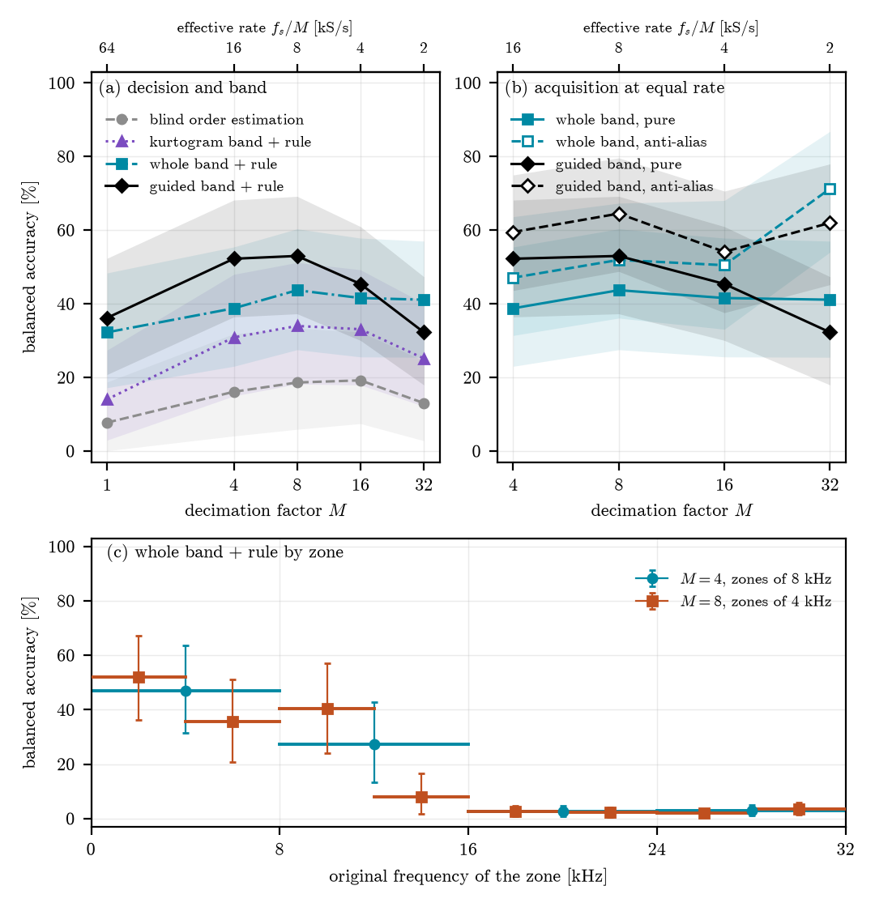

# E26 - Seleção de banda guiada pelas ordens de falha, no fluxo já decimado

Aberto em 2026-11-12, depois do piloto negativo do E25.

## Por que este experimento

O E20, o E23 e o E25 mostram que a captura sob decimação pura é um problema de **escolha da
banda**. O seletor cego (curtose) vai para onde a energia impulsiva dobrada cai. No piloto do E25,
uma banda fixa acertou 92 % com o interferente, contra 23–38 % do kurtograma cego, mas essa banda
foi calibrada com a falha presente.

Aqui o seletor escolhe a banda pelo que interessa ao diagnóstico: a raia nas ordens de falha que a
geometria do rolamento dá (BPFO e BPFI). Um interferente que não é cíclico nessas ordens não ganha
a escolha. Tudo é feito no fluxo já decimado, sem taxa cheia e sem comissionamento. A ideia é a dos
seletores dirigidos da literatura (`mauricio2020iesfogram`). O que se testa aqui é se ela evita a
captura sob decimação pura.

## O cuidado que muda a métrica

Com o prior das ordens, "estimar a ordem" perde o sentido. Uma busca a ±2 % da ordem nominal cai
dentro da tolerância por construção (no Ottawa, ±0,07 contra a tolerância de 0,06), e isso seria o
prior acertando, não a medição. Por isso a métrica é de **identificação**:
- **O que o método decide:** qual falha está presente (pista externa, pista interna ou nenhuma),
  pela proeminência da raia em cada ordem candidata.
- **Limiar:** o percentil 95 do escore nos registros **sãos**, por fator. Dá 5 % de alarme falso.
  É a separação entre medição e prior: sem falha, o método tem de dizer "nenhuma".
- **Comparação:** o acerto do kurtograma cego do E20 nos mesmos segmentos também é uma
  identificação. Uma estimativa dentro da tolerância da falha verdadeira identifica a falha certa.

## Piloto exploratório (2026-11-12, NÃO pré-registrado)

O piloto decide se vale um pré-registro. Os números dele não vão ao artigo como confirmatórios.

- **Dados.** Ottawa, com os 36 registros: 12 sãos, 12 de pista interna e 12 de pista externa. São
  3 segmentos de 2,5 s cada, os mesmos do E20.
- **Fatores e busca.** Fatores 1, 2, 3, 4, 5, 6 e 8. Busca de 500 Hz até min(25 kHz, f_s/2M), com
  a partição do kurtograma até o nível 3 (24 bandas).
- **Escore.** Para cada banda e falha candidata c, é a média, nas harmônicas k = 1, 2, 3, da
  proeminência da raia: o pico a ±2 % de k·o_c dividido pela mediana a ±7 %. As ordens o_c vêm da
  geometria (BPFO = 3,573 e BPFI = 5,427). O escore da falha é o máximo sobre as bandas.
- **Decisão.** A falha de maior escore, se ele passar do limiar dos sãos naquele fator. Senão,
  "nenhuma".
- **Métricas.**
  - acerto de identificação por pista e balanceado;
  - alarme falso, com o limiar calibrado nos próprios sãos, ou seja, dentro da amostra;
  - o kurtograma cego do E20 (`results/metrics.csv`, braço `none`, teto de 25 kHz, régua
    aninhada) nos mesmos segmentos.

## Resultado do piloto, primeira rodada (janela de ±2 %, `results-pilot/`)

| fator | guiado: externa | guiado: interna | guiado: sãos corretos | cego (E20): externa | cego (E20): interna |
|---|---|---|---|---|---|
| 1× | 0 % | 100 % | 94 % | 75 % | 97 % |
| 4× | 0 % | 100 % | 94 % | 17 % | 97 % |
| 8× | 0 % | 100 % | 94 % | 69 % | 100 % |

**Por que a pista externa fica em 0 %, até em 1×.**
- A BPFO real do Ottawa fica 4 % abaixo da nominal: a mediana da régua aninhada é 3,432, contra
  3,573.
- Na régua local, ela vai de 3,33 a 3,79, porque a raia deriva com a rotação.
- A janela de ±2 % nunca a alcança, e o escore da pista externa fica no nível dos sãos (mediana de
  3,2, contra 3,4).
- Na pista interna, a BPFI real fica a 0,2 % da nominal, e o acerto é de 100 %.
- **Foi erro do desenho, e não um efeito da decimação.** O E07 e o E20 calibram o Ottawa em ±12 %
  justamente por essa incerteza.

## Revisão do piloto, segunda rodada (2026-11-12, depois da primeira; `results-pilot-w12/`)

- **Janela:** ±12 % em torno de cada ordem candidata, com o pico e a mediana na mesma janela. É o
  span de calibração do Ottawa no E07 e no E20.
- **Harmônicas:** só 1 e 2. Com a janela larga, 3·BPFO sobreporia 2·BPFI.
- **O resto não muda,** inclusive o limiar nos sãos.
- A revisão foi feita depois de ver a primeira rodada. Ela corrige um erro de desenho conhecido de
  antemão, mas é um piloto exploratório e assim deve ser lido.

## Resultado da segunda rodada (janela de ±12 %, `results-pilot-w12/`)

| fator | guiado: externa | guiado: interna | limiar (sãos) | cego (E20): externa |
|---|---|---|---|---|
| 1× | 100 % | 100 % | 7,0 | 75 % |
| 2× | 72 % | 100 % | 11,2 | 56 % |
| 3× | **100 %** | 100 % | 6,2 | 11 % |
| 4× | 11 % | 100 % | **14,3** | 17 % |
| 5× | 6 % | 100 % | **14,9** | 6 % |
| 6× | **97 %** | 100 % | 8,7 | 31 % |
| 8× | 97 % | 100 % | 8,4 | 69 % |

Os sãos ficam corretos em 94 % dos segmentos, em todos os fatores.

**Por que 4× e 5× falham.**
- Nos registros **sãos**, aparecem raias fortes dentro da janela da BPFI, em ordens de 5,63 a 5,84,
  com a 2ª harmônica em 11,26–11,67.
- Elas surgem nas bandas altas (12,7–25 kHz), justamente onde os picos dobrados caem, e não em
  ordens inteiras. Mudam de registro para registro.
- Isso é compatível com um trem de picos de taxa fixa em Hz, que, sob rotação variável, aparece em
  ordens diferentes.
- O limiar calibrado nos sãos sobe, e a pista externa deixa de passar.
- É o modo de falha esperado do seletor guiado: um interferente cíclico perto de uma ordem
  candidata.

## Terceira variante (2026-11-12): mediana de 3 no fluxo decimado antes do seletor guiado

É a mesma janela de ±12 %, com a correção do E20 aplicada antes. Testa se os picos produzem as
raias falsas dos sãos (`pilot.py --clean median3`, `results-pilot-w12-median3/`). Também é
exploratória e foi decidida depois de ver a segunda rodada.

### Resultado da terceira variante (`results-pilot-w12-median3/`)

| fator | mediana + guiado: externa | interna | limiar (sãos) | sem mediana: externa | cego (E20): externa |
|---|---|---|---|---|---|
| 1× | 19 % | 100 % | **13,9** | 100 % | 75 % |
| 2× | **89 %** | 100 % | 10,4 | 72 % | 56 % |
| 3× | **100 %** | 100 % | 5,9 | 100 % | 11 % |
| 4× | **97 %** | 100 % | 8,7 | 11 % | 17 % |
| 5× | **100 %** | 100 % | 7,1 | 6 % | 6 % |
| 6× | **100 %** | 100 % | 5,8 | 97 % | 31 % |
| 8× | **100 %** | 100 % | 7,1 | 97 % | 69 % |

Os sãos ficam corretos em 94 % dos segmentos, em todos os fatores. É dentro da amostra.

**Leitura** (exploratória):
- **De 2× a 8×, a combinação identifica a pista externa em 89–100 % dos segmentos,** contra 6–69 %
  do kurtograma cego, com a pista interna em 100 %.
  - Em 4× e 5×, o limiar dos sãos volta a 7–9. Os picos dobrados eram a fonte das raias falsas.
  - Como referência indireta, a mediana seguida do kurtograma (E20, `results-post-median`) acerta
    a **ordem** em 75–81 % de 4× a 8×. A métrica aqui é de identificação, então a comparação não é
    exata.
- **Em 1× a combinação cai para 19 %:** o limiar dos sãos sobe para 13,9, sem explicação por ora.
  Não é o regime sub-Nyquist, mas precisa ser entendido.

**Limites:**
- O desenho foi revisado duas vezes depois de ver os dados.
- O limiar é calibrado nos mesmos sãos em que se mede o alarme falso.
- O kurtograma cego não tem limiar de alarme falso nesta comparação. O controle de sãos do E07
  (`healthy_control.csv`) é a referência para isso.

**Antes do artigo:** é preciso uma rodada **pré-registrada** em dados que não serviram para ajustar
o desenho (o Paderborn), com:
- janela de busca fixada a priori pela incerteza de ordem do conjunto;
- limiar em rolamentos sãos com validação cruzada;
- os mesmos baselines: kurtograma cego, mediana + kurtograma e teto baixo.

## Confirmação no Paderborn (pré-registro, 2026-11-13)

Escrito e commitado antes de rodar, junto com `run_paderborn.py`, `analyze_paderborn.py` e
`config/paderborn.yaml`. O desenho fica fixo daqui em diante. O piloto do Ottawa **não** faz parte
do teste, porque foi revisado duas vezes depois de ver os dados. O Paderborn não serviu para
ajustá-lo.

- **Dados.**
  - 23 rolamentos danificados (12 de pista externa e 11 de pista interna, os do E24) e os 6 sãos
    (K001–K006).
  - Os três ajustes de 1500 rpm, com as medições 2 a 20 de 255 936 amostras.
  - A medição 1 dos danificados serve à régua aninhada (`line_calibration` do E24).
- **Fatores:** 1, 4, 8, 16 e 32. Decidem 4, 8, 16 e 32; o 1 é descritivo.
- **Braços,** todos no fluxo já decimado:
  - `kurtograma`, o pipeline cego do E24;
  - `mediana_kurtograma`, a mediana de 3 seguida do kurtograma;
  - `guiado`, o seletor guiado sem limpeza;
  - `mediana_guiado`, a mediana de 3 seguida do seletor guiado.
- **Seletor guiado,** com parâmetros fixados a priori:
  - **Ordens:** as da geometria, BPFO = 3,0543 e BPFI = 4,9457, e só as harmônicas 1 e 2.
  - **Janela de ±2 %:** é a dispersão de 1 a 2 % entre fabricantes (PHME16, seção 3).
  - **Ordens inteiras excluídas, ±0,015.** No Paderborn, a BPFO e a BPFI ficam 0,054 da 3ª e da
    5ª harmônica do eixo, e a rotação é constante. A resolução em 4 s é de 0,01 ordem.
  - **Partição:** a do kurtograma, níveis 1 a 3, com 23 bandas até o Nyquist efetivo.
  - **Escore:** a proeminência média, isto é, o pico dividido pela mediana na própria janela.
- **Limiar:** o percentil 95 dos escores dos sãos, por fator e limpeza. Para avaliar cada são, o
  limiar sai dos outros 5.
- **Identificação.**
  - **Cego:** pista externa ou interna, se a ordem estimada ficar a ≤ 0,025 da verdadeira; senão,
    "nenhuma". A verdadeira é a régua aninhada do E24 para a própria pista, e a mediana de todas as
    calibrações para a outra pista e para os sãos.
  - **Guiado:** a falha de maior escore, se ele passar do limiar; senão, "nenhuma".
- **Métricas.**
  - Acurácia balanceada nos danificados: a média, sobre as pistas, do acerto por rolamento.
  - Especificidade nos sãos: a fração de "nenhuma".
- **Hipóteses.**
  - **H1:** `mediana_guiado` > `kurtograma`.
  - **H2:** `mediana_guiado` > `mediana_kurtograma`. É o ganho do seletor guiado além da limpeza.
  - **O teste:** troca de sinal por rolamento, estratificada por pista, unilateral, nas diferenças
    de acerto por rolamento. É exata até 2^18 combinações e Monte Carlo com 10^6 acima disso. A
    revisão do E24 mostrou que o bootstrap é anticonservador com tão poucos aglomerados.
  - Holm sobre os 4 fatores, com α = 0,05.
  - **Um fator passa** se o p de Holm ficar abaixo de 0,05, a diferença for positiva e a
    especificidade do `mediana_guiado` ali for de pelo menos 90 %.
- **O que refutaria.** A H1 cai se nenhum fator passar. O mesmo vale para a H2.
- **Limites declarados.**
  - O cego não tem limiar de alarme falso; a especificidade dele nos sãos é reportada.
  - A régua aninhada vem de poucas calibrações, medidas na banda que o kurtograma escolhe (revisão
    do E24). Ela só entra na identificação do cego.
  - A janela do guiado (±2 %) é mais larga que a tolerância do cego (0,025). O preço disso é o
    alarme falso, controlado pelo limiar dos sãos.

**Correção antes da rodada completa (2026-11-13).** A fumaça, com 6 rolamentos, 1 ajuste, 2
medições e os fatores 1 e 4, rodou, mas a análise quebrou ao procurar o fator 8, que ela não tinha.
A análise passou a testar só os fatores decisivos presentes nos dados. Nenhum critério mudou, e os
números da fumaça não foram olhados.

## Resultado da confirmação no Paderborn (2026-11-13; sob revisão adversarial)

- **Rodada:** `results-paderborn/`, de 00:25 a 05:21 UTC, 16 470 linhas.
  - Os hashes do config, do `run_paderborn.py`, do `guided.py`, do README e do `run.py` do E24
    batem com o commit `57a6a89`. Não houve recorte de fumaça.
  - 6 medições ficaram de fora por arquivo curto, rotação fora de 4 s ou `.mat` ilegível. A
    lista está no manifest.
- **Veredito pré-registrado** (`analysis.json`): a H1 e a H2 passam nos quatro fatores decisivos.
- **Acurácia balanceada (%), régua aninhada no cego e limiar dos sãos no guiado:**

  | braço | 1× | 4× | 8× | 16× | 32× |
  |---|---|---|---|---|---|
  | `kurtograma` | 7,7 | 16,1 | 18,6 | 19,2 | 13,0 |
  | `mediana_kurtograma` | 15,6 | 18,8 | 27,8 | 20,8 | 17,4 |
  | `guiado` | 36,2 | 52,2 | 53,0 | 45,4 | 32,2 |
  | `mediana_guiado` | 38,3 | 49,0 | 50,9 | 45,2 | 25,2 |

  - A especificidade nos sãos é de 93,9 a 95,0 % nos braços guiados e de 99,4 a 100 % nos cegos.
- **Testes** (troca de sinal por rolamento, estratificada por pista, Holm sobre 4, 4× a 32×):
  - **H1** (`mediana_guiado` contra `kurtograma`): +32,9, +32,3, +26,0 e +12,2 pontos, com 16 de
    17, 17 de 18, 18 de 19 e 21 de 22 rolamentos discordantes a favor. O p de Holm fica abaixo de
    0,001 nos quatro.
  - **H2** (`mediana_guiado` contra `mediana_kurtograma`): +30,2, +23,1, +24,3 e +7,8 pontos, com
    p de Holm de 0,0004, 0,0014, 0,0006 e 0,031.
- **O que o veredito não diz, e que a revisão precisa atacar:**
  - **A mediana não contribui no Paderborn.** O `guiado`, sem limpeza, empata com o
    `mediana_guiado` ou fica acima dele. Em 32× fica 7 pontos acima.
  - **O ganho já existe em 1×,** com 36,2 % contra 7,7 %. Então não é específico da decimação:
    no Paderborn o kurtograma já é capturado na taxa cheia (E24).
  - **Os braços mudam duas coisas ao mesmo tempo:** a banda e a regra de identificação.
    - O guiado escolhe entre as duas ordens da geometria, com limiar calibrado nos sãos.
    - O cego estima a ordem sem prior e precisa acertar a ±0,025.
    - O ganho pode vir da regra de identificação, não da banda. Isso foi declarado no
      pré-registro como limite, mas não foi separado.

## E26b: a regra fixa, a banda muda (pré-registro, 2026-11-13)

Escrito e commitado antes de rodar, junto com `run_paderborn_rule.py`, `analyze_paderborn_rule.py`
e `config/paderborn_rule.yaml`.

- **Pergunta.** A confirmação mudou duas coisas ao mesmo tempo: a banda e a regra de
  identificação. O ganho vem do seletor de banda guiado ou da regra guiada?
  - A regra: as janelas das ordens da geometria e o limiar dos sãos.
- **O que fica igual ao E26:**
  - os dados, os fatores, as duas limpezas e as janelas;
  - o escore de cada falha;
  - o limiar: percentil 95 dos escores máximos dos sãos, por braço, fator e limpeza, deixando o
    próprio são de fora quando ele é o avaliado;
  - a decisão: a falha de maior escore, ou "nenhuma".
- **O que muda: só a banda em que o escore é medido.**
  - `guiado`: o máximo sobre as 23 bandas da partição, do `results-paderborn/metrics.csv` do E26,
    sem recalcular.
  - `kurtograma_regra`: a banda do kurtograma rápido até o Nyquist efetivo, a mesma do braço cego.
  - `banda_larga_regra`: [500 Hz, fs/2], sem seleção. É o envelope clássico.
  - `infograma_ses_regra`: a banda do infograma SES (descritivo).
  - `sorteada_regra`: uma banda sorteada da partição, com semente por segmento (descritivo).
- **Hipóteses** (troca de sinal por rolamento, estratificada por pista, como no E26):
  - **H3:** o `guiado` fica acima do `kurtograma_regra`. O teste é feito nas duas limpezas e em
    4×, 8×, 16× e 32×, com Holm sobre os 8.
  - **H4:** o `guiado` fica acima do `banda_larga_regra`, do mesmo jeito.
  - Um teste passa se o p de Holm ficar abaixo de 0,05 e a diferença for positiva. A
    especificidade é a mesma por construção nos braços, perto de 95 %, e é reportada.
- **Leitura combinada antes do resultado:**
  - **H3 e H4 passam:** a escolha de banda guiada soma à regra, e o seletor é a contribuição.
  - **As duas falham:** o ganho do E26 vem da regra, isto é, do prior e do limiar dos sãos. A
    alegação do artigo fica sobre a regra, não sobre o seletor de banda.
  - **Resultado misto:** reportado como misto, por fator e limpeza.
- **Checagem de integridade.** Onde a banda sorteada coincide com a banda guiada de uma falha, o
  escore tem de ser idêntico nos dois arquivos. Se não for, a comparação não vale.
- **Limite declarado.** O Paderborn já foi visto no E26, e este pré-registro foi motivado pelo
  resultado dele. Os escores das quatro estratégias novas ainda não foram calculados. O braço de
  referência fica fixo como saiu do E26.

### Revisão adversarial (`reviewer-2`, 2026-11-13): revisão maior

Os scripts da revisão estão em `exploratory/review_2026-11-13/`. Reproduzi a diferença em
diferenças (`a2_did.py`) e a contagem por rolamento (`a10_bearinglevel.py`).

- **O que sobreviveu:**
  - **Reprodução.** A análise reproduz bit a bit a partir do CSV, e os hashes batem.
  - **O prior não inventa detecções.** Dada uma detecção do `mediana_guiado`, a pista sai certa em
    91 a 100 % de 1× a 16×, e em 84 a 92 % em 32×. O candidato errado passa do limiar nos
    danificados em 0 a 7,7 % dos segmentos, o nível do alarme falso.
  - **A régua do cego é justa.** Trocar a régua ou abrir a tolerância move o cego no máximo 4,3
    pontos.
  - **A H1 não depende de um rolamento.** Tirando qualquer um, o mínimo fica em +29,5, +29,0,
    +22,5 e +8,9.
  - **Por rolamento** (identificado se mais de 50 % dos segmentos saem certos): em 4× e 8×, o
    guiado com mediana identifica 12 de 23 rolamentos e o cego, 4. São 8 só pelo guiado e 0 só
    pelo cego (McNemar, p = 0,004). Nenhum são dá alarme.
- **Ataques, do mais grave ao menos grave:**
  1. **O ganho não vem da decimação.** Em 1× ele já é de +30,6 pontos, com 16 de 16 rolamentos a
     favor. A diferença em diferenças por rolamento, ganho no fator menos ganho em 1×, fica em
     +2,3 [−13,5; +17,5] (4×), +1,7 [−14,5; +17,5] (8×), −4,6 [−19,0; +9,0] (16×) e
     −18,4 [−32,5; −4,5] (32×; p bilateral 0,012). O guiado "melhorar" de 1× para 4× é
     artefato do limiar único, puxado pela janela da BPFO nos sãos.
  2. **A banda e a regra estão confundidas, e o cego falha pela regra.**
     - O argmax cego cai numa raia do banco na ordem 2,10 em 38,8 % dos segmentos danificados e
       em 58,2 % dos sãos.
     - Na mesma banda, a regra guiada ganha do argmax cego: de 69,4 contra 34,7 % em 8× a
       60,4 contra 32,0 % em 32×.
     - O E26b é o desenho certo, mas falta gravar a ordem do pico na janela.
  3. **Faltam os baselines honestos.**
     - O guiado com anti-alias na mesma taxa: é o controle decisivo para "decimação pura". O
       E24b mostra que, no Paderborn, o cego com teto em 1× ganha da decimação pura.
     - A amostragem passa-faixa clássica com envelope (`lu2018undersampled`).
     - Ao menos um seletor dirigido publicado.
  4. **A novidade se sobrepõe à literatura.** Seleção de banda pelas frequências de falha
     conhecidas já existe: o log-cicligrama (Smith et al., MSSP 2019), o IFBIgram (Schmidt et
     al., MSSP 2020) e `mauricio2020iesfogram`. Harmônicas de falha em vibração subamostrada:
     Tang et al. (Sensors 2015) e `lu2018undersampled`.
  5. **A mediana não contribui.** Comparada ao guiado sem limpeza, ela muda de +2,1 a −7,1
     pontos, e o −7,1 em 32× vai contra ela (p = 0,044).
  6. **A exclusão das ordens inteiras (±0,015) é menor que o lóbulo da janela de Hann.**
     Vazamento da raia do eixo pode gerar proeminência sem falha. Pedido: gravar a ordem do
     pico, testar ±0,03 e usar janelas-isca.
  7. **A especificidade é estimativa pontual com 6 sãos.**
     - O IC vai de 88,6 a 99,7 % em 4×.
     - Por rolamento são, ela cai até 75,4 %.
     - O limiar exige dados de estado são do mesmo banco.
  8. **Heterogeneidade.**
     - Em 4×, 8 rolamentos ficam acima de 80 % e 8 abaixo de 10 %.
     - A pista interna artificial (KI03, KI05, KI07 e KI08) e os reais de nível 1 nunca são
       identificados.
     - Em 32× não há diferença por rolamento (4 contra 3).
  9. **Parede física.** `x[::M]` dobra só o que passou pela cadeia analógica do Paderborn, não a
     banda do track-and-hold de um amostrador real.
  10. **Proveniência.** Os hashes são calculados no fim da rodada, e o manifest não grava o commit
      nem se a árvore estava suja.
- **Frase aceita pelo revisor:**
  > On Paderborn (23 damaged, 6 healthy bearings, 1500 rpm), a fault-order-targeted rule with a
  > healthy-calibrated threshold identified the faulty race in 49–53 % of segments (12 of 23
  > bearings) at 1/4 and 1/8 of the original rate by plain decimation, against 16–19 % (4 of 23)
  > for the blind kurtogram with an unrestricted envelope peak, at about 94 % against 100 %
  > specificity. The advantage was of the same size at full rate (+30.6 points) and shrank at
  > 1/32, so it is not attributable to decimation.
- **Não aceita:**
  - que o seletor guiado com mediana melhore a identificação sob decimação;
  - que ele evite a captura sob decimação;
  - atribuir o ganho à escolha de banda antes do E26b;
  - que a mediana contribua;
  - "aquisição sub-Nyquist" no sentido de hardware.
- **Consequência:**
  - O E26 vira um efeito de prior e de regra, presente em todas as taxas.
  - O que ainda pode ser contribuição: o quanto desse efeito sobrevive à decimação pura,
    comparado ao anti-alias na mesma taxa.
  - Isso pede o E26b, mais uma rodada com o anti-alias, a ordem do pico e a exclusão de ±0,03,
    e o baseline passa-faixa.

## E26c: decimação pura contra anti-alias e passa-faixa (pré-registro, 2026-11-13)

Escrito e commitado antes de rodar, junto com `run_paderborn_acq.py`, `analyze_paderborn_acq.py` e
`config/paderborn_acq.yaml`. É a resposta aos ataques 3 e 6 da revisão.

- **Pergunta.** Na mesma taxa FS/M, deixar tudo dobrar (`x[::M]`) perde ou ganha informação para a
  regra guiada, frente a filtrar antes de decimar? Este é o controle decisivo para qualquer frase
  sobre decimação pura.
- **Escopo:**
  - só o fluxo bruto, porque a mediana não contribuiu no E26;
  - fatores 4, 8, 16 e 32;
  - os mesmos rolamentos, ajustes e medições de teste.
- **Aquisições,** com filtros ideais por máscara na FFT da taxa cheia:
  - `pura`: `x[::M]`;
  - `antialias`: passa-baixas em FS/(2M), depois `[::M]`;
  - `zona{k}`: passa-faixa em [k, k+1]·FS/(2M), depois `[::M]`, só em 4× e 8×. É a amostragem
    passa-faixa clássica (`lu2018undersampled`, `vaughan1991`); a `zona0` é o anti-alias.
- **Bandas,** sempre com a regra do E26:
  - `guiado` (máximo sobre a partição) e `kurtograma_regra`, em `pura` e `antialias`;
  - `banda_larga_regra` ([500 Hz, fs/2]), em todas as aquisições.
- **Escolha da zona no passa-faixa:**
  - `zona_kurtograma`: a zona do centro da banda do kurtograma em taxa cheia na medição 1 do
    próprio rolamento e ajuste. É o comissionamento que um praticante faria.
  - `zona_frota`: a zona de maior acurácia balanceada nos outros rolamentos danificados,
    deixando o próprio rolamento de fora.
- **Hipóteses** (troca de sinal por rolamento, estratificada por pista, unilateral):
  - **H5:** `pura|guiado` > `antialias|guiado` em 4×, 8×, 16× e 32×, com Holm sobre 4.
  - **H6:** `pura|guiado` > `zona_frota|banda_larga_regra` em 4× e 8×, com Holm sobre 2.
  - Um fator passa se o p de Holm ficar abaixo de 0,05 e a diferença for positiva.
- **Leitura combinada antes do resultado:**
  - **H5 passa:** a dobra carrega informação que o anti-alias joga fora. É a frase de decimação
    pura que o artigo pode escrever.
  - **H5 falha com diferença ≤ 0:** o que a regra usa está abaixo de FS/(2M). No Paderborn, a
    decimação pura não traz vantagem sobre filtrar.
  - **H6 falha com o passa-faixa acima:** a amostragem passa-faixa com uma zona escolhida na frota
    é o melhor desenho na mesma taxa.
- **Descritivos:**
  - o kurtograma e a banda larga, `pura` contra `antialias`;
  - o perfil de acurácia por zona;
  - `zona_kurtograma`.
- **Vazamento (ataque 6),** no `pura|guiado`:
  - entre as detecções nos danificados, a fração com o pico da 1ª harmônica a até 0,03 de uma
    ordem inteira;
  - a acurácia com a exclusão de ±0,03.
- **Iscas:**
  - a fração de segmentos em que a maior de 4 janelas-isca, em 0,9 e 1,1 vez a BPFO e a BPFI,
    passa do limiar, nos danificados e nos sãos;
  - a mesma fração para a falha verdadeira, para comparar.
- **Integridade.** Os escores do `pura|guiado` têm de ser idênticos aos do guiado bruto do E26.
- **Limites declarados:**
  - o Paderborn já foi visto no E26, no E26b e na revisão;
  - os filtros são ideais, não analógicos;
  - `x[::M]` dobra só o que passou pela cadeia analógica do banco, não a banda do track-and-hold
    de um amostrador real (revisão, ataque 9).

### Resultado do E26b (2026-11-13): misto

- **Rodada:** `results-paderborn-regra/`, 65 880 linhas, sem recorte de fumaça. Os hashes batem
  com `14c68d9`.
- **Integridade:** 1474 casamentos entre a banda sorteada e a banda guiada, com diferença máxima de
  0,0. Os escores dos dois arquivos são o mesmo cálculo.
- **Acurácia balanceada (%), regra fixa e limiar dos sãos.** Especificidade de 89,8 a 95,0 % em
  todos os braços. O cego do E26 entra só para comparar.

  | fluxo bruto | 1× | 4× | 8× | 16× | 32× |
  |---|---|---|---|---|---|
  | kurtograma cego (E26) | 7,7 | 16,1 | 18,6 | 19,2 | 13,0 |
  | `kurtograma_regra` | 14,1 | 30,9 | 34,0 | 33,1 | 25,1 |
  | `sorteada_regra` | 15,1 | 36,6 | 35,2 | 32,3 | 10,8 |
  | `infograma_ses_regra` | 36,0 | 43,4 | 39,0 | 34,0 | 24,6 |
  | `banda_larga_regra` | 32,2 | 38,8 | 43,7 | 41,5 | 41,1 |
  | `guiado` | 36,2 | 52,2 | 53,0 | 45,4 | 32,2 |

  | mediana de 3 | 1× | 4× | 8× | 16× | 32× |
  |---|---|---|---|---|---|
  | `kurtograma_regra` | 20,0 | 32,1 | 50,7 | 34,8 | 25,2 |
  | `banda_larga_regra` | 51,8 | 45,1 | 46,8 | 47,0 | 32,7 |
  | `guiado` | 38,3 | 49,0 | 50,9 | 45,2 | 25,2 |

- **H3** (guiado contra `kurtograma_regra`; Holm sobre 8):
  - **No bruto, passa em 4×, 8× e 16×:** +21,4, +19,0 e +12,3 pontos, com 18 de 20, 18 de 19 e 13
    de 18 rolamentos a favor (Holm ≤ 0,003). Em 32× fica em +7,1, Holm 0,17.
  - **Com a mediana, passa em 4× e 16×:** +16,9 e +10,4. Em 8× e 32× empata.
- **H4** (guiado contra `banda_larga_regra`):
  - **No bruto, passa em 4× e 8×:** +13,5, com 18 de 18 a favor, e +9,3. Em 16× fica em +3,8, sem
    passar, e em 32× fica −8,9, com a banda larga à frente.
  - **Com a mediana, passa só em 4×,** por +3,8.
- **Leitura, pela chave do pré-registro: misto.**
  - **A regra explica parte do ganho do E26.** Na mesma banda do kurtograma, ela leva o acerto de
    16,1 para 30,9 % em 4× e de 13,0 para 25,1 % em 32×.
  - **A banda guiada soma à regra contra a banda do kurtograma,** de +12 a +21 pontos de 4× a 16×
    no bruto.
  - **Contra o envelope de banda larga com a mesma regra, a banda guiada só ganha em 4× e 8×.**
    Em 32× perde.
  - **O envelope de banda larga com o prior e o limiar dos sãos é um baseline forte:** de 39 a
    44 % de 4× a 32× no bruto, e 52 % em 1× com a mediana. A seleção de banda, guiada ou não, é o
    componente menor.
- **Consequência:** a alegação do E26 passa a ser sobre a regra e só parcialmente sobre a banda. O
  E26c decide o que sobra para a decimação pura.

### Resultado do E26c (2026-11-13): no Paderborn, o anti-alias ganha da decimação pura

- **Rodada:** `results-paderborn-aquisicao/`, 55 998 linhas, sem recorte de fumaça. Os hashes batem
  com `996e4ed`.
- **Integridade:** 13 176 casamentos entre o `pura|guiado` e o guiado bruto do E26, com diferença
  de 0,0.
- **Acurácia balanceada (%), fluxo bruto, regra do E26.** Especificidade de 89,8 a 95,0 %:

  | braço | 4× | 8× | 16× | 32× |
  |---|---|---|---|---|
  | `pura|guiado` | 52,2 | 53,0 | 45,4 | 32,2 |
  | `antialias|guiado` | 59,5 | 64,5 | 54,1 | 62,0 |
  | `pura|kurtograma_regra` | 30,9 | 34,0 | 33,1 | 25,1 |
  | `antialias|kurtograma_regra` | 60,7 | 62,6 | 63,8 | 50,3 |
  | `pura|banda_larga_regra` | 38,8 | 43,7 | 41,5 | 41,1 |
  | `antialias|banda_larga_regra` | 47,0 | 51,9 | 50,5 | 71,2 |
  | `zona_kurtograma|banda_larga_regra` | 14,7 | 16,0 | – | – |
  | `zona_frota|banda_larga_regra` | 47,0 | 51,9 | – | – |

- **Perfil por zona** (banda larga com a regra):
  - **4×:** zona 0 (anti-alias) 47,0; zona 1 27,5; zona 2 2,5; zona 3 3,0.
  - **8×:** zona 0 51,9; zona 1 35,6; zona 2 40,4; zona 3 8,1; zonas 4 a 7 de 2,0 a 3,5.
  - A frota escolhe a zona 0 em todos os rolamentos. O passa-faixa pela frota é o anti-alias.
- **H5 falha** (`pura|guiado` > `antialias|guiado`). A decimação pura fica abaixo:
  - −7,3 em 4×, −11,5 em 8×, −8,7 em 16× e −29,7 em 32×;
  - 2 a 4 rolamentos a favor, de 15 a 18;
  - Holm de 1,0.
- **H6 falha** (`pura|guiado` > `zona_frota`): +5,1 em 4× (Holm 0,087) e +1,1 em 8×.
- **Vazamento** (ataque 6 da revisão):
  - Entre as detecções nos danificados, só 1,0 a 2,5 % têm o pico da 1ª harmônica a até 0,03 de
    uma ordem inteira.
  - Com exclusão de ±0,03, o acerto fica em 49,8, 51,3, 44,5 e 30,4 %, contra 52,2, 53,0, 45,4 e
    32,2 %.
  - O vazamento das raias do eixo não explica as detecções.
- **Iscas:**
  - A maior isca passa do limiar em 7,6 a 15,4 % dos segmentos danificados e em 3,5 a 8,2 % dos
    sãos. A falha verdadeira passa em 33,0 a 53,9 % dos danificados.
  - A detecção é majoritariamente específica da falha. Há um excesso de conteúdo não específico
    nos danificados, de cerca de 2× o nível dos sãos.
- **Leitura:**
  - **No Paderborn, a informação de diagnóstico está na banda base.**
    - Os rolamentos com falha se identificam abaixo de FS/(2M).
    - As zonas altas, a partir de 16 kHz em 4× e de 12 kHz em 8×, não trazem nada. Elas contêm o
      conteúdo impulsivo que captura o kurtograma (E24).
    - Decimar sem filtro dobra essas zonas sobre a banda útil e custa de 7 a 30 pontos em
      qualquer escolha de banda.
  - **Comissionar a zona pelo kurtograma em taxa cheia falha** (15 a 16 %), porque ele escolhe a
    zona capturada.
  - **No Ottawa é o contrário** (E20 e E23): a ressonância da falha está alta, e o anti-alias custa
    27 pontos em 10× e 12×.
  - **A vantagem da decimação pura depende de onde está a banda informativa** em relação à
    interferência. Isso se mede por zona, antes de escolher a aquisição.
  - **A melhor aquisição do Paderborn, na mesma taxa, é a clássica:** anti-alias, taxa baixa e
    envelope com a regra das ordens de falha. Chega a 71,2 % em 32× (2 kS/s) com a banda larga.

## Figura (2026-11-13)

Gerada por `papers/shared/figures/fig_rule_paderborn.py`, que refaz a decisão a partir dos três
`metrics.csv`. O script confere cada ponto contra o `analysis.json` da rodada (±0,1 ponto) e para se
algo divergir. As bandas são IC de 95 % por bootstrap dos rolamentos dentro de cada pista.
- (a) decisão e banda sob decimação pura;
- (b) decimação pura contra anti-alias na mesma taxa;
- (c) perfil por zona de Nyquist em 4× e 8×.
